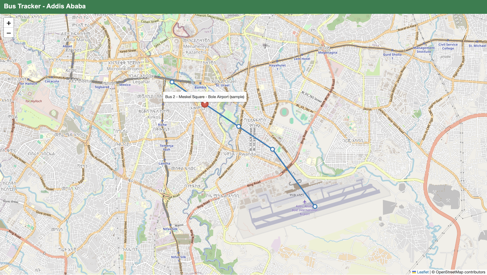

# Bus Tracker

A live bus tracking web app, built to solve a real problem in Addis Ababa: many buses have no GPS trackers, so riders wait at stops without knowing when the bus will arrive.

**Live demo:** https://danayitdev.pythonanywhere.com/

## How it works

- **Driver page** (`/driver`): the driver picks a bus ID and a route, then taps one button. The phone shares its GPS location.
- **Server** (`server.py`): a Flask app that saves each bus's latest location in a SQLite database.
- **Rider map** (`/`): a Leaflet map that draws the route and stops, asks the server for bus locations every 5 seconds, and shows an estimated arrival time when you hover over a stop.

## Run it locally

1. Install Python 3 and Flask: `pip install flask`
2. Start the server: `python server.py`
3. Open `http://127.0.0.1:5001/` for the rider map.
4. Open `http://127.0.0.1:5001/driver` and click "Start sharing location".

## Tech used

Python, Flask, SQLite, JavaScript, Leaflet, OpenStreetMap, HTML, CSS. Deployed on PythonAnywhere.

## Current limits

- The route and stops are placeholders, not surveyed bus stops.
- Arrival estimates assume a fixed speed of 20 km/h, so they are rough.
- Anyone who knows the driver page link can send locations (driver login is next).

## Roadmap

- [x] Support multiple buses
- [x] Routes and stops
- [x] Estimated arrival time at a stop
- [x] Database storage
- [x] Deploy online so drivers can use it from a phone
- [ ] Hide buses that stopped reporting
- [ ] Driver login
- [ ] Real Addis Ababa stops
- [ ] Learn each bus's real speed for better arrival times
